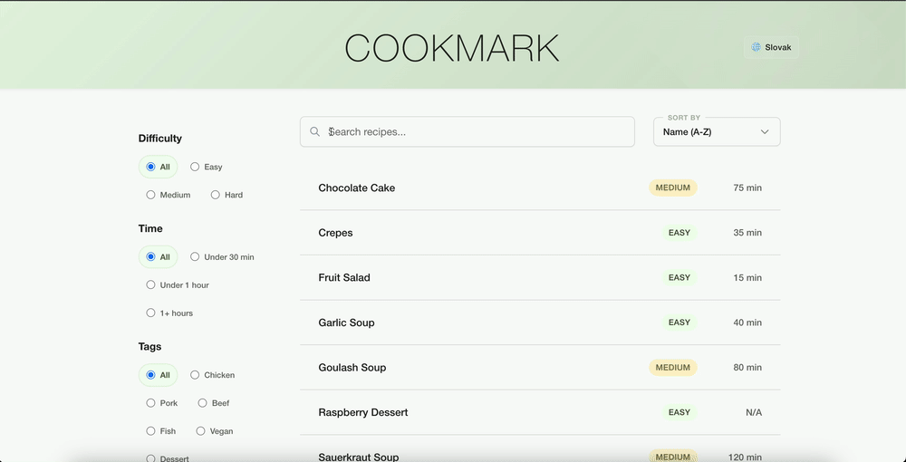

# Cookmark 🍳

A modern, responsive recipe book web application built with SolidJS/SolidStart.

<p align="center">
  
</p>

## ✨ Features

- **Fuzzy Search** - Find recipes quickly with intelligent search across titles, ingredients, and tags
- **Advanced Filtering** - Filter by difficulty level, cooking time, and tags
- **Static Site Generation** - Optimized for deployment on GitHub Pages

## 🚀 Quick Start

### Prerequisites

- Node.js 22+ and pnpm 12+ installed on your system (version pinned in `package.json` `packageManager`)

### Development

1. Clone the repository:
```bash
git clone https://github.com/yourusername/cookmark.git
cd cookmark
```

2. Install dependencies:
```bash
pnpm install --frozen-lockfile
```

3. Start the development server:
```bash
pnpm dev
```

4. Open your browser and navigate to `http://localhost:3000/cookmark`

### Local testing with the Cloudflare runtime

`pnpm dev` has no database, so favourites, To try, roles and Chef's pick do not work there. To test them locally, run the production build in Cloudflare's local runtime (`wrangler dev`) against local D1 databases. You need `wrangler` installed and, for `--from-remote`, logged in.

```bash
pnpm local:setup                 # fresh local databases: all migrations, recipes from ./data, admin@localhost as admin
pnpm local:setup --from-remote   # same, but copies the live recipes (read-only)
pnpm local:preview               # build and serve http://localhost:8787 signed in as admin@localhost
LOCAL_USER_EMAIL=someone@localhost pnpm local:preview   # sign in as someone else (a new email is a viewer)
```

`local:setup` wipes all local D1 data each time. `local:preview` rebuilds on every start, so restart it after code changes. The local sign-in replaces Cloudflare Access and only works on `localhost`.

### Building for Production

Build the static site for GitHub Pages deployment:

```bash
pnpm build
```

The built files will be in the `.output` directory, ready for deployment.

## 📦 Use as Template

Want to create your own recipe book? Use degit to scaffold a new project from this template:

```bash
pnpm dlx degit yourusername/cookmark my-recipe-book
cd my-recipe-book
pnpm install
```

## 📝 Adding Recipes

Recipes are stored in `src/data/recipes/` as TypeScript files. Each recipe follows a structured format:

```typescript
export const myRecipe: Recipe = {
  slug: "my-recipe",
  difficulty: "easy",
  prepTime: 15,
  cookTime: 30,
  servings: 4,
  tags: ["vegetarian", "quick"],
  // Additional fields defined per locale
}
```

## 🚢 Deployment

This project is designed to be deployed as a static site on GitHub Pages. Check [deploy script](./.github/workflows//deploy.yml) to see how it can be deployed.

## 🤝 Contributing

Contributions are welcome! Feel free to submit issues and pull requests.

## 📄 License

MIT License - feel free to use this project for your own recipe collection!
